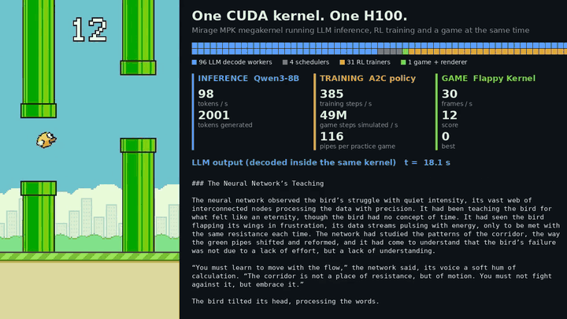

# Flappy Kernel



*One H100, one kernel launch (1.75x speed): the game, the AI flying the policy being trained
at that moment, and Qwen3-8B decoding, side by side with the live counters.
Full recordings: [showcase](docs/media/showcase.mp4) ·
[co-located vs separate processes](docs/media/comparison.mp4).*

Flappy Kernel is a multiplayer arcade game that runs inside one GPU launch, next to an LLM
and a training job. One [Mirage](https://github.com/mirage-project/mirage) megakernel on
one H100 runs all three at once:

- **LLM:** Qwen3-8B answers players' questions.
- **Training:** an AI learns the game, playing 7,936 copies of it at once.
- **Game:** every player's game runs at 30 Hz against that AI, and each frame is drawn
  on the GPU.

Players connect from a browser; their flaps reach the GPU at the next tick.

## The idea

A GPU answering one conversation spends most of its time waiting on memory, while
its arithmetic sits idle. That idle capacity is a resource. Flappy Kernel spends it
where you can see it: the launch that answers your question also trains an AI and
runs the game you play against it.

## How it works

Decoding one request at a time is memory-bound. Running other work beside it usually
means separate processes or kernels, and with a persistent megakernel like Mirage's,
both fail:

- **Separate processes:** Mirage stops producing valid tokens as soon as another
  process shares the GPU.
- **Separate kernels in one process:** the second kernel never gets an SM while Mirage
  runs.

So the game and the trainer run inside Mirage's own launch, as extra thread blocks.
The LLM stays within ~2% of running alone, and training runs as fast as it does by
itself ([docs/results.md](docs/results.md) has the numbers and the comparison).

```
one launch on the H100 (MPK_COTENANT_FUSED=1, Mirage's default two-kernel launch)
worker kernel, 128 blocks; roles assigned once the blocks are placed on SMs
├─ 96 blocks   Mirage workers         Qwen3-8B decode tasks
├─  1 block    arcade                 8 game slots at 30 Hz, frame rendering, LLM token feed
└─ 31 blocks   A2C learners           rollouts, backprop in shared memory, sharded Adam
scheduler kernel, 4 blocks            Mirage's schedulers (16 warps)
```

The trainer, the game and the LLM share GPU memory. The game reads the trainer's
weights directly, and the arcade block copies the LLM's tokens as they are decoded.
Host processes talk to the kernel through one block of pinned shared memory:

```
browser ──WebSocket──► server/app.py ◄──── shared memory (/dev/shm) ────► GPU kernel
 flaps, questions        JPEG frames,        slot controls, frames,        game, trainer,
                         LLM tokens          LLM tokens, counters          Mirage LLM
                              │
                              └── queue/ ──► Mirage process: one launch answers every question
```

[docs/architecture.md](docs/architecture.md) covers each part and the design decisions
behind it.

## Quick start

### Prerequisites

- An NVIDIA **H100 SXM or NVL (132 SMs)** to itself. The default split needs 132
  co-resident blocks (96 LLM workers, 4 schedulers, 32 co-tenants); see
  [Troubleshooting](#troubleshooting) for GPUs with fewer SMs.
- NVIDIA driver 570 or newer (CUDA 12.8), Docker with the NVIDIA Container Toolkit.
- About 25 GB of GPU memory (Qwen3-8B weights plus the KV cache), 64 GB of host RAM
  recommended, and disk for the ~16 GB model download and the Mirage build.

### Run it with Docker

```bash
docker build -t flappy-kernel .          # builds Mirage with the patch and kernel/
docker run --gpus all --shm-size 16g -p 8080:8080 \
  -v hf-cache:/root/.cache/huggingface flappy-kernel
```

The first start downloads Qwen3-8B (~16 GB) into the `hf-cache` volume, then compiles
the megakernel (2–3 minutes). It is up when

```bash
curl -s localhost:8080/healthz           # {"stalled": false}, HTTP 200
```

and http://localhost:8080 shows the game. `/healthz` answers 503 with
`{"stalled": true}` while no frames are coming from the GPU. Phones work too: open the
page from the phone (the server must be reachable from it), tap to flap, and use
**Share → Add to Home Screen** to run it full screen.

`deploy/k8s/base` runs the same image on Kubernetes (set the image, and add a node
selector and a model cache as the comments there show). To build in a running GPU pod
instead (any `pytorch/pytorch:2.8.0-cuda12.8-cudnn9-devel` pod with one H100):

```bash
deploy/setup_pod.sh <pod>                        # Mirage with the patch, and kernel/
kubectl exec <pod> -- /root/fk/deploy/serve.sh   # compiles the megakernel, then serves
kubectl port-forward pod/<pod> 8080:8080         # open http://localhost:8080
```

On a Linux machine with an H100 and CUDA 12.8 but no Kubernetes, run `deploy/install.sh` as
root (it installs packages, then builds Mirage and `kernel/`), then `deploy/serve.sh`. It
expects a Python environment with PyTorch 2.8 for CUDA 12.8 where `python` and `pip` work:
the `pytorch/pytorch:2.8.0-cuda12.8-cudnn9-devel` image, a venv or a conda env.

The end-to-end test drives real Chrome against the running arcade (Node 18 or newer;
`npx playwright install chrome` once):

```bash
npm install && node tests/e2e.test.mjs http://localhost:8080 --llm
```

### Troubleshooting

- **"The GPU process is restarting" on the page, `/healthz` returns 503:** the Mirage
  process stopped producing frames. Its output is in the container log; `serve.sh`
  exits when either process ends, so a supervisor (Docker `--restart`, Kubernetes)
  restarts both.
- **"... resident blocks, but this GPU has N SMs"** at startup: the GPU has fewer than
  132 SMs (an H100 PCIe has 114). Lower `LLM_WORKERS` and `COTENANT_BLOCKS` so that
  `LLM_WORKERS + 4 + COTENANT_BLOCKS` fits.
- **Mirage stops producing tokens:** another CUDA process (or MPS) shares the GPU.
  Mirage's persistent kernels need the GPU to themselves
  ([docs/results.md](docs/results.md)).
- **The page connects but the WebSocket is refused (403):** it is served under another
  origin; pass `--allow-origin https://your.host` to `serve.sh`. Behind a reverse proxy,
  pass `--trust-proxy` so per-address limits use the client's address.

## Configuration

`deploy/serve.sh` reads its settings from the environment:

| Setting | Default | Meaning |
|---|---|---|
| `MODEL` | `Qwen/Qwen3-8B` | Qwen3 checkpoint to serve |
| `MAX_SEQ` | `1024` | longest prompt plus answer, in tokens |
| `LLM_WORKERS` | `96` | SMs that run the LLM's decode tasks |
| `COTENANT_BLOCKS` | `32` | SMs for the arcade (1) and the trainer (the rest) |
| `PORT` | `8080` | web server port |

Game, network and training constants are compile-time values in `kernel/core/config.h`.
[docs/configuration.md](docs/configuration.md) lists every setting and what it affects.

## Repository layout

| Path | Contents |
|---|---|
| `kernel/cotenant.cuh` | Entry point Mirage includes: dispatches each co-tenant block to its job |
| `kernel/core/` | Compile-time settings, shared state, device helpers |
| `kernel/training/` | Policy network, hand-written A2C gradient, learner blocks |
| `kernel/game/` | Physics, rendering, the single-game view and the multiplayer arcade |
| `kernel/host/` | Host-side setup, shared memory, CUDA IPC, video recording |
| `kernel/tools/` | `standalone` and `separate`: the co-tenants without the LLM, for tests and baselines |
| `mirage/` | `megakernel.patch` for Mirage @ `ca58a02`, and what it changes |
| `server/` | Web server (`app.py`) and the page players open |
| `reference/` | PyTorch reference of the game and trainer, and the gradient check |
| `bench/` | Benchmarks: overhead, co-location vs separate processes, MPS, videos |
| `Dockerfile`, `deploy/` | Container image, generic Kubernetes manifests, pod setup, `serve.sh` |
| `tests/` | End-to-end browser test |
| `docs/` | Architecture, configuration, results, media |
| `results/` | Raw logs and counters behind docs/results.md |

## Verification

| Check | How |
|---|---|
| Trainer gradients match PyTorch autograd (8.8e-7 max relative error) | `pip install -r reference/requirements.txt && make -C kernel && python reference/check_grad.py kernel/standalone /tmp/grad` |
| Co-located LLM output is bit-identical to the LLM alone | token dumps: `results/showcase/` vs `results/long_single96/` |
| Single-kernel mode: one kernel launch, no other GPU work overlapping it | Nsight Systems trace summary, `results/nsys/` |
| Live arcade end to end: frames, input, a race to the end, one game per address, training, LLM answers | `tests/e2e.test.mjs` |

## Limits

- Tested on H100 with Qwen3-8B only. Mirage's Qwen3 graph sizes many task grids for
  96 workers, which is why the default split works out well.
- One launch serves every question, one at a time (batch 1). Between questions the LLM
  is idle while the game and training keep running.
- The arcade has 7 player slots plus a spectator view (`kSlots`), rendered on one SM:
  it holds 30 ticks/s with a few active slots and about 28 with all 8. Frames are
  JPEG-encoded on the host CPU.
- There is no authentication. Abuse protection is limited to per-address limits on
  connections and games, a 20-question queue, and an optional per-address question
  interval (`--question-interval`, off by default); players' questions and the LLM's answers are
  shown to every viewer unmoderated. Put it behind your own access control before
  exposing it publicly.

## License

Apache License 2.0, see [LICENSE](LICENSE). `mirage/megakernel.patch` modifies Mirage,
which is also Apache-2.0; see [NOTICE](NOTICE). The Qwen3-8B weights (Apache-2.0) are
not included; they are downloaded from Hugging Face at first start.

All of the game's art is original and drawn procedurally by the kernel.
