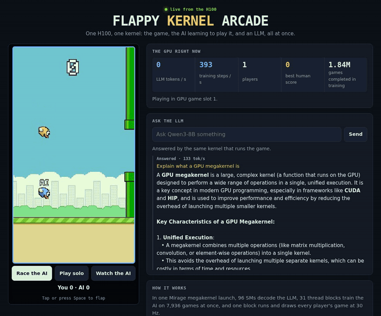

<h1 align="center">Flappy Kernel</h1>

<p align="center">
  <a href="docs/media/race.mp4"></a>
</p>

Flappy Kernel is an arcade game: fly a bird through the pipes and race an AI bird that is
learning the game as you play. Up to 7 people can play at once.

All of it runs inside one GPU launch, next to an LLM. One
[Mirage](https://github.com/mirage-project/mirage) megakernel on one H100 runs three jobs
at once:

- **LLM:** Qwen3-8B answers players' questions.
- **Training:** the AI learns the game, playing 7,936 copies of it at once.
- **Game:** every player's game runs at 30 Hz, and each frame is drawn on the GPU.

Players connect from a browser; their flaps reach the GPU at the next tick.

## The idea

An LLM running on a GPU and answering one request at a time spends most of its time
waiting on memory, while the GPU's arithmetic units sit idle. That idle capacity is a
resource. Flappy Kernel spends it where you can see it: the same kernel launch that runs
the LLM also trains an AI and runs the game you play against it.

## How it works

Decoding one token at a time is memory-bound. Running other work beside it usually
means separate processes or kernels, and with a persistent megakernel like Mirage's,
both fail:

- **Separate processes:** Mirage stops producing valid tokens as soon as another
  process shares the GPU.
- **Separate kernels in one process:** the second kernel never gets an SM while Mirage
  runs.

So the game and the trainer run inside Mirage's own launch, as extra thread blocks.
The LLM stays within ~2% of running alone, and training runs as fast as it does by
itself ([docs/results.md](docs/results.md) has the numbers and the comparison).

```
one launch on the H100 (MPK_COTENANT_FUSED=1, Mirage's default two-kernel launch)
worker kernel, 128 blocks; roles assigned once the blocks are placed on SMs
├─ 96 blocks   Mirage workers         Qwen3-8B decode tasks
├─  1 block    arcade                 8 game slots at 30 Hz, frame rendering, LLM token feed
└─ 31 blocks   A2C learners           rollouts, backprop in shared memory, sharded Adam
scheduler kernel, 4 blocks            Mirage's schedulers (16 warps)
```

The trainer, the game and the LLM share GPU memory. The game reads the trainer's
weights directly, and the arcade block copies the LLM's tokens as they are decoded.
Host processes talk to the kernel through one block of pinned shared memory:

```
browser ──WebSocket──► server/app.py ◄──── shared memory (/dev/shm) ────► GPU kernel
 flaps, questions        JPEG frames,        slot controls, frames,        game, trainer,
                         LLM tokens          LLM tokens, counters          Mirage LLM
                              │
                              └── queue/ ──► Mirage process: one launch answers every question
```

[docs/architecture.md](docs/architecture.md) covers each part and the design decisions
behind it.

## Quick start

You need an NVIDIA **H100** to itself with driver 570 or newer (CUDA 12.8), about 25 GB of
GPU memory, 64 GB of host RAM and 20 GB of disk for the model.

On Kubernetes:

```bash
# Installing NVIDIA dependencies if not present: when the GPU nodes don't expose
# nvidia.com/gpu yet, NVIDIA's GPU Operator installs the driver, the container toolkit
# and the device plugin (add --set driver.enabled=false if the nodes have a driver).
helm repo add nvidia https://helm.ngc.nvidia.com/nvidia && helm repo update
helm install gpu-operator nvidia/gpu-operator -n gpu-operator --create-namespace --wait
kubectl get nodes -o custom-columns=NODE:.metadata.name,GPUS:.status.allocatable.'nvidia\.com/gpu'

# Installing Flappy Kernel to run it
helm install flappy-kernel deploy/helm/flappy-kernel
kubectl port-forward svc/flappy-kernel 8080:80
```

With Docker, after installing the
[NVIDIA Container Toolkit](https://docs.nvidia.com/datacenter/cloud-native/container-toolkit/latest/install-guide.html):

```bash
# Checking the NVIDIA dependencies: Docker can use the GPU
docker run --rm --gpus all ubuntu nvidia-smi

# Installing Flappy Kernel to run it
docker build -t flappy-kernel .
docker run --gpus all --shm-size 16g -p 8080:8080 -v hf-cache:/root/.cache/huggingface flappy-kernel
```

Then open http://localhost:8080. The first start downloads Qwen3-8B (~16 GB) and compiles
the megakernel; the arcade is up when `curl -s localhost:8080/healthz` returns
`{"stalled": false}`. Phones work too: tap to flap.

[docs/deployment.md](docs/deployment.md) explains how the parts connect, the chart's
settings, running on a plain machine, putting the arcade on a public address, and
troubleshooting.

## Configuration

`deploy/serve.sh` reads its settings from the environment:

| Setting | Default | Meaning |
|---|---|---|
| `MODEL` | `Qwen/Qwen3-8B` | Qwen3 checkpoint to serve |
| `MAX_SEQ` | `1024` | longest prompt plus answer, in tokens |
| `LLM_WORKERS` | `96` | SMs that run the LLM's decode tasks |
| `COTENANT_BLOCKS` | `32` | SMs for the arcade (1) and the trainer (the rest) |
| `PORT` | `8080` | web server port |

Game, network and training constants are compile-time values in `kernel/core/config.h`.
[docs/configuration.md](docs/configuration.md) lists every setting and what it affects.

## Repository layout

| Path | Contents |
|---|---|
| `kernel/cotenant.cuh` | Entry point Mirage includes: dispatches each co-tenant block to its job |
| `kernel/core/` | Compile-time settings, shared state, device helpers |
| `kernel/training/` | Policy network, hand-written A2C gradient, learner blocks |
| `kernel/game/` | Physics, rendering, the single-game view and the arcade |
| `kernel/host/` | Host-side setup, shared memory, CUDA IPC, video recording |
| `kernel/tools/` | `standalone` and `separate`: the co-tenants without the LLM, for tests and baselines |
| `mirage/` | `megakernel.patch` for Mirage @ `ca58a02`, and what it changes |
| `server/` | Web server (`app.py`) and the page players open |
| `reference/` | PyTorch reference of the game and trainer, and the gradient check |
| `bench/` | Benchmarks: overhead, co-location vs separate processes, MPS, videos |
| `Dockerfile`, `deploy/` | Container image, Helm chart, `install.sh`, `serve.sh`, pod setup |
| `tests/` | End-to-end browser test |
| `docs/` | Architecture, deployment, configuration, results, media |
| `results/` | Raw logs and counters behind docs/results.md |

## Verification

| Check | How |
|---|---|
| Trainer gradients match PyTorch autograd (8.8e-7 max relative error) | `pip install -r reference/requirements.txt && make -C kernel && python reference/check_grad.py kernel/standalone /tmp/grad` |
| Co-located LLM output is bit-identical to the LLM alone | token dumps: `results/showcase/` vs `results/long_single96/` |
| Single-kernel mode: one kernel launch, no other GPU work overlapping it | Nsight Systems trace summary, `results/nsys/` |
| Live arcade end to end: frames, input, a race to the end, one game per address (it moves to the newest page), training, LLM answers | `tests/e2e.test.mjs` |

## Limits

- Tested on H100 with Qwen3-8B only. Mirage's Qwen3 graph sizes many task grids for
  96 workers, which is why the default split works out well.
- One launch serves every question, one at a time (batch 1). Between questions the LLM
  is idle while the game and training keep running.
- The arcade has 7 player slots plus a spectator view (`kSlots`), rendered on one SM:
  it holds 30 ticks/s with a few active slots and about 28 with all 8. Frames are
  JPEG-encoded on the host CPU.
- There is no authentication. Abuse protection is limited to per-address limits on
  connections and games, a 20-question queue, and an optional per-address question
  interval (`--question-interval`, off by default); players' questions and the LLM's answers are
  shown to every viewer unmoderated. Put it behind your own access control before
  exposing it publicly.

## License

Apache License 2.0, see [LICENSE](LICENSE). `mirage/megakernel.patch` modifies Mirage,
which is also Apache-2.0; see [NOTICE](NOTICE). The Qwen3-8B weights (Apache-2.0) are
not included; they are downloaded from Hugging Face at first start.

All of the game's art is original and drawn procedurally by the kernel.
